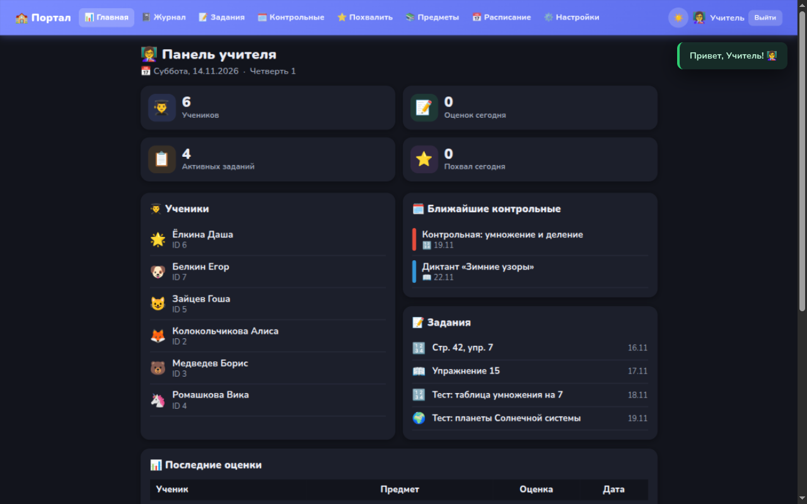
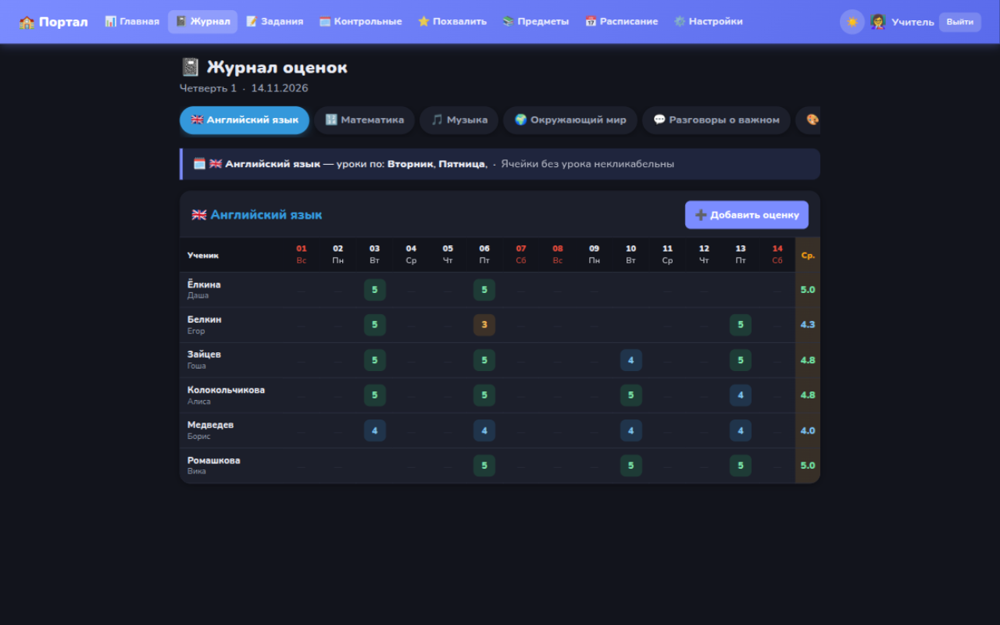
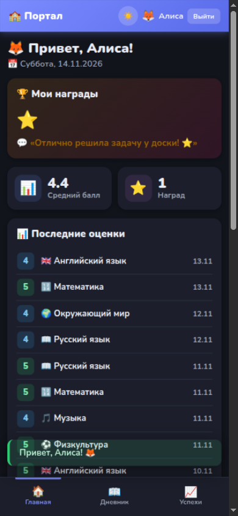
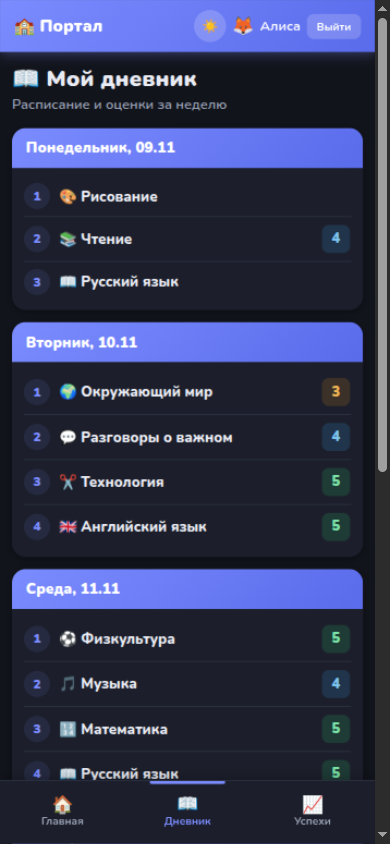
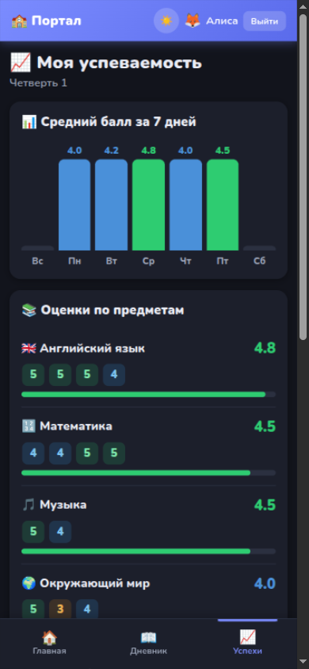
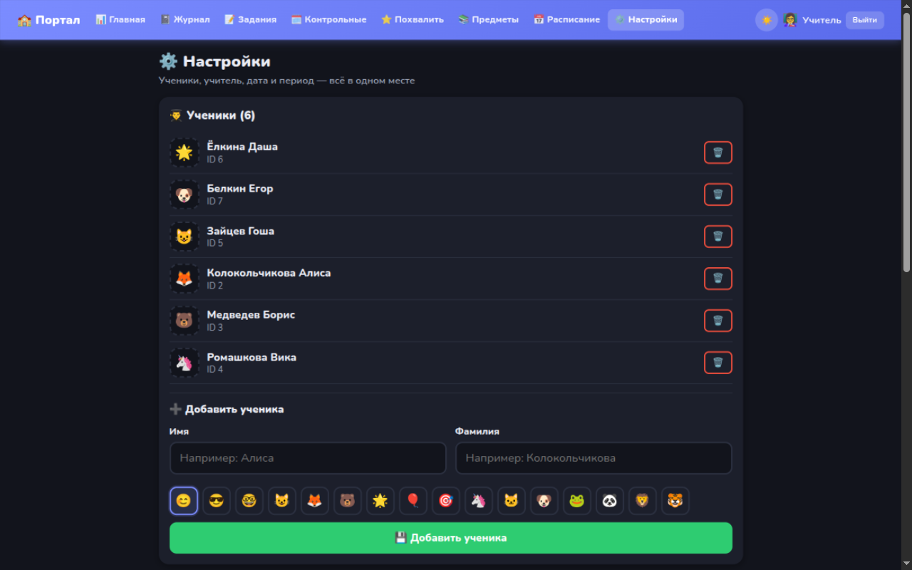
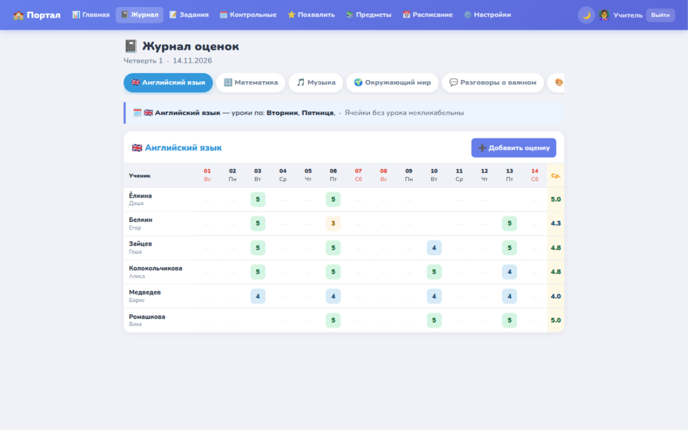

# 🏫 Школьный портал-игра

Веб-портал для игры «в школу» — сделан для игры с младшей сестрой, но подойдёт
любому ребёнку. Родитель играет учителя, ребёнок — ученика: настоящие оценки в
журнал, настоящая домашка, настоящие награды за старания 😄

Работает офлайн: запустил на домашнем компьютере, открыл с телефона — и «школа»
готова. Всё на русском, всё с эмодзи, всё дружелюбно.

## ✨ Что внутри

**Для учителя** 👩‍🏫
- 📓 **Журнал оценок** — таблица за 14 дней, оценка в один тап по ячейке,
  клик по поставленной оценке меняет или удаляет её, средний балл считается сам
- 📝 **Конструктор заданий** — домашка и тесты с вопросами (варианты или
  текстовый ответ), результаты каждого ученика с автоматической проверкой
- 🗓️ **Календарь контрольных** — месячная сетка с цветными метками
- ⭐ **Похвалить** — 8 видов наград (звезда, грамота, корона, огонь…) с
  сообщениями и рейтингом
- 📚 **Предметы и расписание** — свои предметы с эмодзи и цветами
- ⚙️ **Настройки прямо в вебе** — добавление учеников со сменой эмодзи,
  «магическая» дата портала (можно поиграть за любой день недели!), четверти
  и триместры

**Для ученика** 🧑‍🎓
- 🏠 **Кабинет** — средний балл, последние оценки, награды, уроки на сегодня,
  будущие контрольные и домашка с отметками «сделано»
- 📖 **Дневник** — расписание и оценки за неделю по дням
- 📈 **Успехи** — график среднего балла за 7 дней, оценки по предметам,
  все награды
- 📝 **Тесты** — прохождение с мгновенным результатом и разбором ответов

Плюс: 🌙 **тёмная тема по умолчанию** (и светлая — переключаются одним
нажатием), 📱 mobile-first интерфейс с нижней навигацией, 🔌 **полный офлайн**
— шрифт Nunito лежит локально, никаких внешних запросов.

## 📸 Скриншоты

| Панель учителя | Журнал оценок |
| --- | --- |
|  |  |

| Кабинет ученика (мобильный) | Дневник (мобильный) | Успехи (мобильный) |
| --- | --- | --- |
|  |  |  |

| Настройки | Светлая тема |
| --- | --- |
|  |  |

Больше скриншотов — в папке [docs/screenshots](docs/screenshots).

## 🚀 Быстрый старт

Нужен Python 3.10+.

```bash
# 1. Виртуальное окружение и зависимости
python -m venv .venv
source .venv/bin/activate        # Windows: .venv\Scripts\activate
pip install -r requirements.txt

# 2. Запуск
python app.py
```

Открывай **http://127.0.0.1:9000** — с телефона в той же Wi-Fi сети:
`http://<IP-компьютера>:9000` (адрес покажет команда `url` в консоли).

При первом запуске база создаётся сама: учитель «Главный Учитель» и
стандартный набор предметов с расписанием. Учеников добавляй прямо в
веб-интерфейсе: **⚙️ Настройки → Добавить ученика**.

### 🎮 Посмотреть с демо-данными

```bash
python demo.py   # вымышленные ученики, оценки, тесты, награды
python app.py
```

Внимание: `demo.py` заполняет ту же базу, что и портал. Для «песочницы»
отдельно от рабочей базы:

```bash
SCHOOL_PORTAL_DB=sqlite:///demo.db python demo.py
SCHOOL_PORTAL_DB=sqlite:///demo.db python app.py
```

## 🖥️ Консоль управления

Дополнительно к веб-интерфейсу есть консоль (`python console.py`) — она умеет
то же самое, плюс пара вещей, которых в вебе нет:

```
status   — статус портала      schedule — редактор расписания уроков
users    — список людей        grades   — сводка оценок
add/qadd — добавить учеников   url      — адрес портала в сети
del      — удалить ученика     reset    — полная очистка данных
date     — дата портала        period   — четверти/триместры
```

## ⚙️ Переменные окружения

| Переменная | По умолчанию | Что делает |
| --- | --- | --- |
| `SCHOOL_PORTAL_DB` | `sqlite:///school.db` | Файл базы данных |
| `SECRET_KEY` | вшитый ключ | Секрет сессий (для публичного доступа задайте свой) |
| `PORT` | `9000` | Порт сервера |
| `HOST` | `0.0.0.0` | Адрес сервера |
| `DEBUG` | `1` | `0` — выключить режим отладки |

## 🧪 Разработка

```bash
pip install -r requirements-dev.txt

ruff check .        # линтер
pytest -v           # тесты (22 шт: доступ, оценки, тесты, каскады, настройки)
python migrate.py   # безопасная миграция старой базы (если была)
```

CI на GitHub Actions гоняет ruff и pytest на Python 3.10–3.14.

## 🛠️ Технологии

- [Flask](https://flask.palletsprojects.com/) + [Flask-SQLAlchemy](https://flask-sqlalchemy.palletsprojects.com/) + [Flask-Login](https://flask-login.readthedocs.io/)
- SQLite (файл `instance/school.db` — в репозиторий не попадает)
- Чистый CSS с переменными тем, без фреймворков
- [Rich](https://rich.readthedocs.io/) для консоли управления
- Шрифт [Nunito](https://fonts.google.com/specimen/Nunito) (локально, OFL-лицензия)

## 📄 Лицензия

MIT — см. [LICENSE](LICENSE).

---

Сделано с ❤️ для одной очень хорошей второклассницы 🦊
